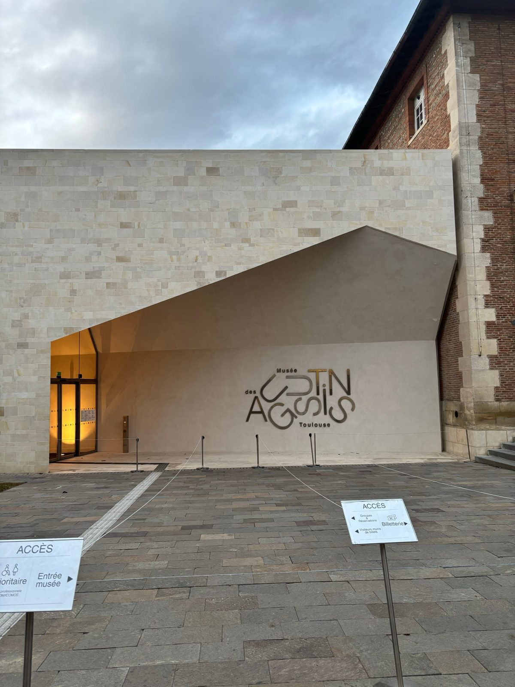
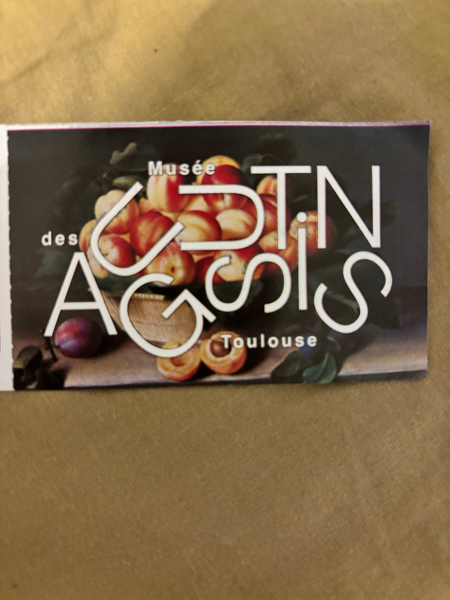
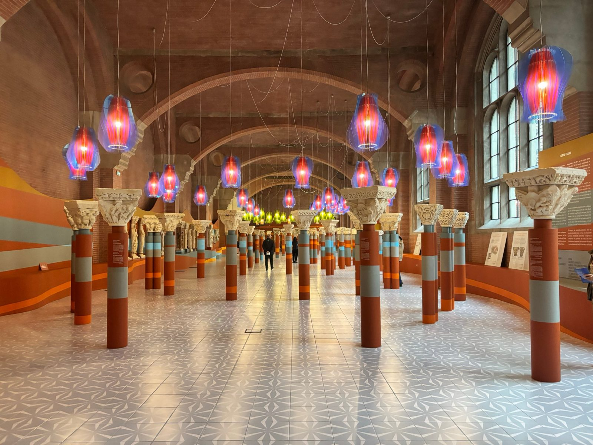
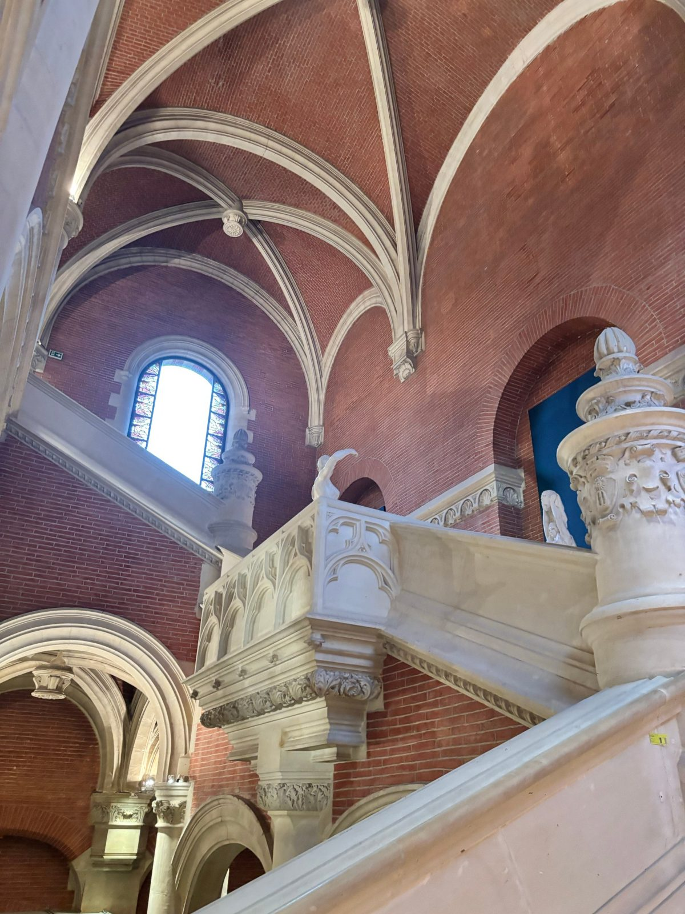
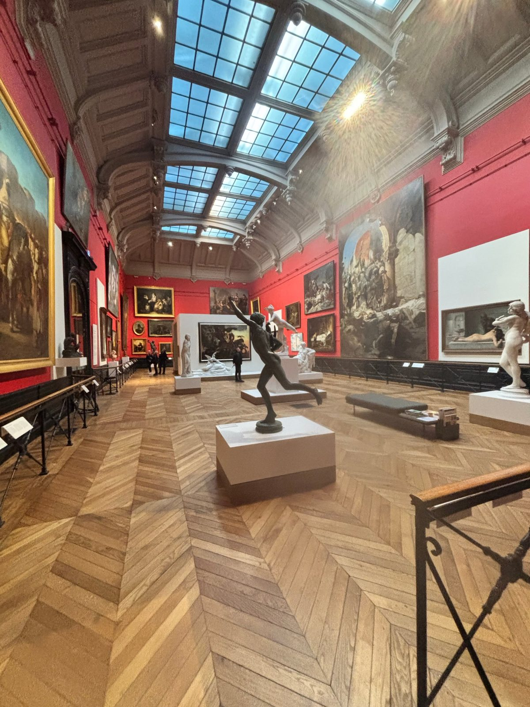
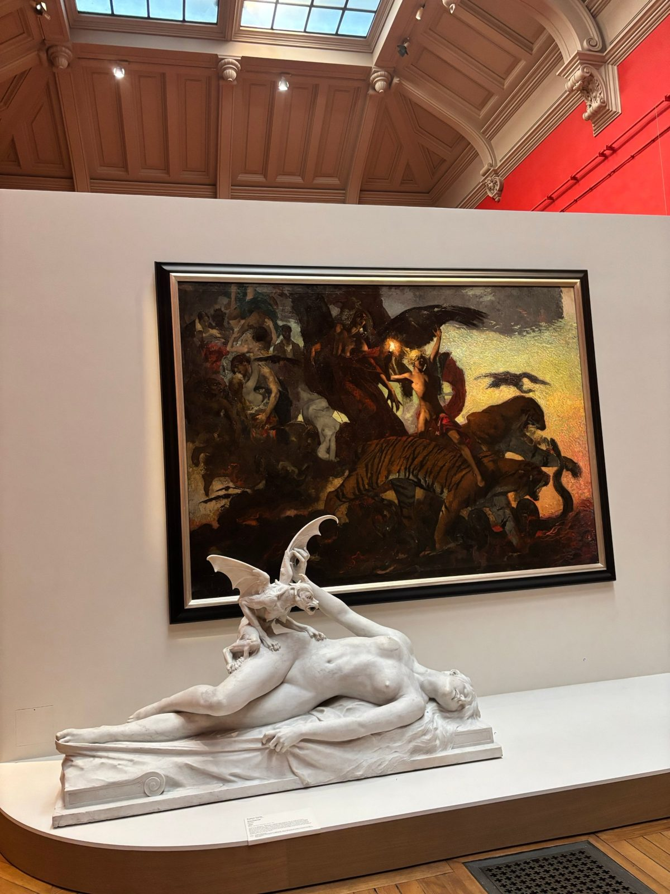
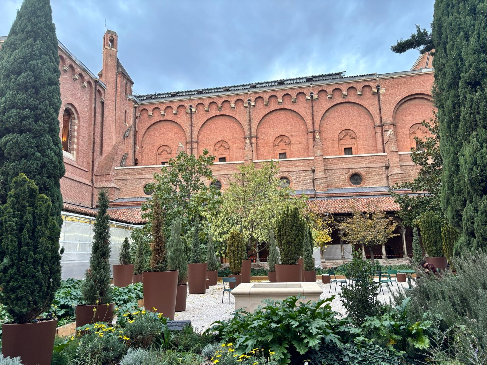
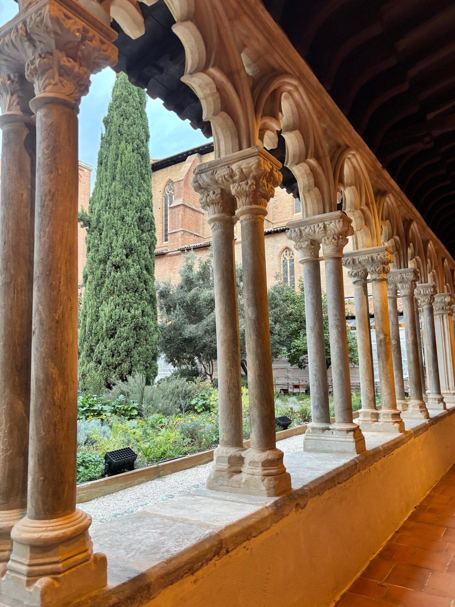

Not a database post this time. I moved to Toulouse in September and I still hadn't visited the city's big art museum, so I finally went to the Musée des Augustins.

Some context: the museum was closed from 2019 to December 2025 for a huge renovation. It's set up in an old Augustinian convent from the 14th century, and it's been a museum since 1795, just two years after the Louvre. So it's old. Very old.

## The new entrance

The first thing you see is the new entrance, designed by the architects Aires Mateus. It's a big white stone wall with a slanted opening cut into it, right next to the old brick building. I like the contrast a lot. It looks super modern but it doesn't fight with the rest.

## The Romanesque room

This was my favorite room, by far. It's full of Romanesque capitals (the carved stone blocks at the top of columns). They're around 1,000 years old and come from old Toulouse cloisters that don't exist anymore, like the ones at Saint-Sernin and La Daurade.

The crazy part is how it's displayed. In 2014 the artist Jorge Pardo redid the whole room: striped columns in orange and grey, patterned floor tiles, and dozens of colored lamps hanging from the ceiling. On paper, mixing medieval sculpture with something that looks like a 70s lounge sounds like a bad idea. In real life it works really well. You actually want to walk around and look at each capital.

## Going upstairs

To get to the painting galleries you take the big staircase. Brick walls, white stone arches, sculptures on the railings. Honestly I spent almost as much time looking at the building as at the art.

Upstairs there are two big painting rooms with red walls and glass ceilings that let natural light in. The paintings are huge, some of them cover almost the whole wall, and there are sculptures everywhere in the middle of the room.

This combo stopped me for a while: a white marble sculpture of a woman lying down with a small winged creature on her, in front of a dark painting full of tigers, birds and people in chaos. Pretty dark mood, but I loved it.

## The cloister

The last part is the cloister. Some of it is still under scaffolding (the restoration is supposed to go until spring 2027), but the garden is open. Cypress trees, plants in big pots, a few chairs. It's calm, and it feels weird to be in the middle of the city and not hear it.

Walking under the arcades with the small double columns, you get a pretty good idea of what the place was like when it was still a convent.

## A quote I took home

There's also a temporary exhibition right now, *La Part des anges* by the artist Nicolas Dhervillers (until February 22, 2027). It's all pastels, drawings and photos about the sky. One sentence from him stuck with me, and I've been thinking about it since:

> « Choisir de créer, aujourd'hui, c'est refuser que le monde se réduise à ce qui l'abîme. »
>
> *"Choosing to create, today, is refusing to let the world be reduced to what damages it."*
>
> — Nicolas Dhervillers

## Worth it?

Yes. A full ticket is around 5 euros, it's right in the center (rue de Metz, near the Esquirol metro), and you can easily spend two hours there. Some parts are still opening little by little, so I'll probably go back once the cloister is fully done.
